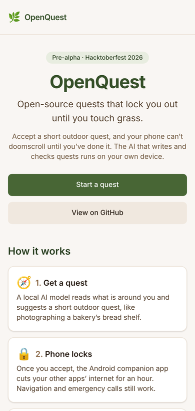
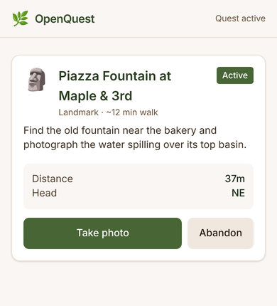
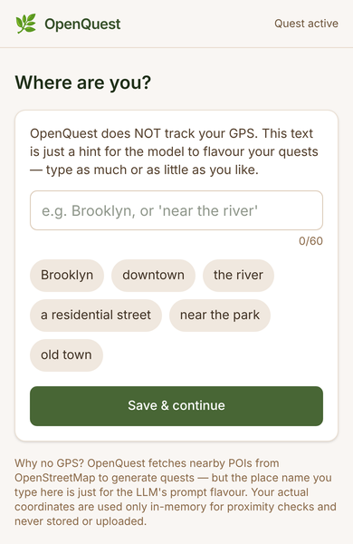
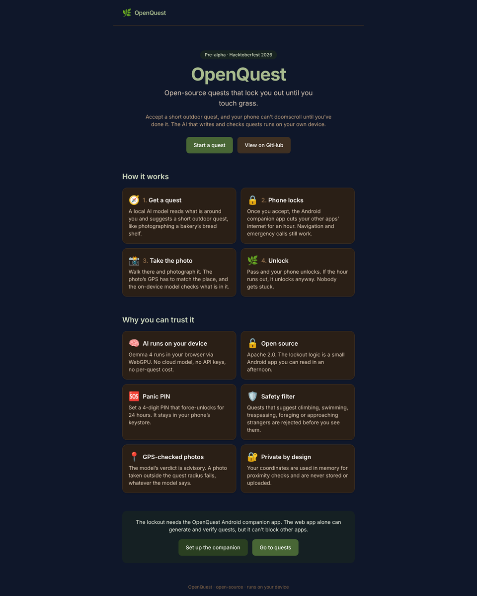
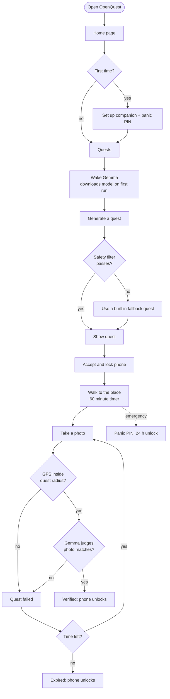
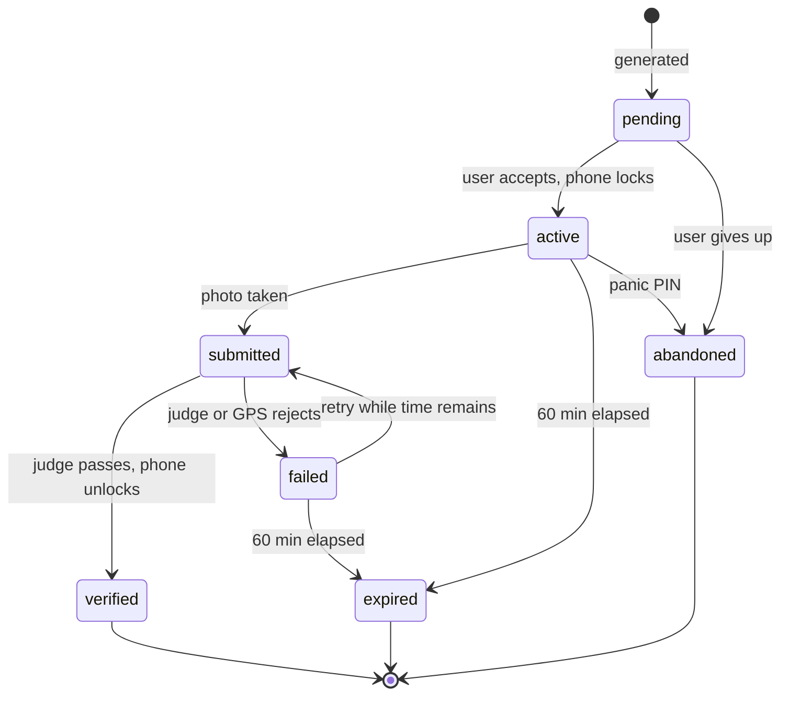
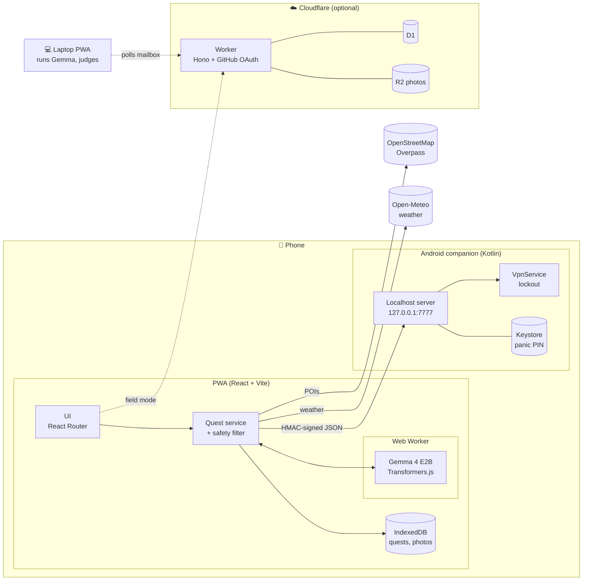
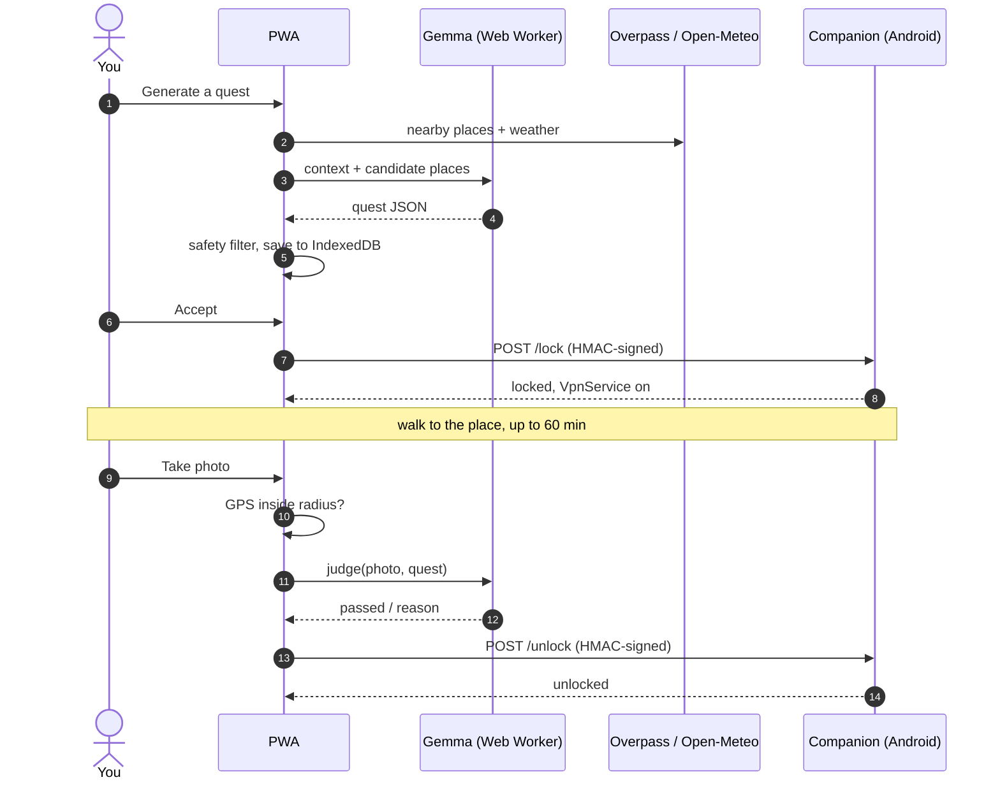

<div align="center">

# 🌿 OpenQuest

**Open-source quests that lock you out until you touch grass.**

An on-device AI writes a short outdoor quest, your phone locks until you've done it, and the same AI checks your photo. No cloud model, no tracking, no server you don't control.

[](https://github.com/Qisanxi/OpenQuest/actions/workflows/ci.yml)
[](LICENSE)

[](CONTRIBUTING.md)

[](https://github.com/Qisanxi/OpenQuest/stargazers)
[](https://github.com/Qisanxi/OpenQuest/issues)


[**Live demo**](#-live-demo) · [**Video**](#-demo-video) · [**How it works**](#-how-it-works) · [**Architecture**](#-architecture) · [**Get started**](#-getting-started) · [**Roadmap**](#-roadmap)

</div>

---

## 📸 Screenshots

<div align="center">

| Home | Active quest | Set your area |
|:---:|:---:|:---:|
|  |  |  |



*Mobile-first and responsive from 320 px to desktop. Quests in these screenshots are sample data; on-device generation needs WebGPU.*

</div>

## 🌐 Live demo

> 🚧 **Coming soon.** There is no public deployment yet.
>
> | | Link |
> |---|---|
> | Web app (PWA) | _TODO: add URL once deployed_ |
> | Companion APK | _TODO: add the GitHub Releases link once a release is cut_ |
> | Worker (optional sync) | _TODO: add URL once deployed_ |

<!-- When you deploy, replace the table above with e.g.:
**Try it:** https://openquest.example.com  ·  **Android companion:** https://github.com/Qisanxi/OpenQuest/releases/latest
-->

## 🎬 Demo video

> 🚧 **Coming soon.** The shot list is in [`docs/DEMO_SCRIPT.md`](docs/DEMO_SCRIPT.md).

<!--
GitHub strips <iframe>, so use a clickable thumbnail for YouTube/Vimeo:

[](https://youtu.be/VIDEO_ID)

Or drag-and-drop an .mp4 (under 10 MB on free plans) into the README editor on github.com;
GitHub uploads it and inserts a playable <video> link here.
-->

<div align="center">

<a href="#-demo-video"></a>

</div>

## ✨ What is OpenQuest?

OpenQuest is an open-source mobile web app that sends you on location-based outdoor quests generated by a local LLM. You accept a quest (*"walk to the bakery 1.2 km away and photograph its bread shelf"*) and the app locks your phone's internet for an hour. You can't doomscroll. The only things your phone can do are navigate, call emergency numbers, and verify your quest.

Take the photo at the location, the on-device multimodal model judges it, and if you pass, the phone unlocks. If the hour runs out, it unlocks anyway, and a 24-hour **panic PIN** is always available.

### Why open beats closed

A closed app that locks your phone is a privacy dystopia: who decides when you're locked out, and where does your location go? OpenQuest works because every piece is auditable.

| | |
|---|---|
| 🧠 **AI on your device** | Gemma 4 E2B runs in the browser via WebGPU. No cloud model, no API keys, no per-quest cost. |
| 🔓 **Open source** | Apache-2.0. The lockout logic is a small Android app (about 900 lines of Kotlin). |
| 🆘 **Your panic PIN** | A 4-digit PIN that force-unlocks for 24 hours, stored in the Android Keystore. |
| 🛡️ **Safety filter** | Quests suggesting climbing, swimming, trespassing, foraging or approaching strangers are rejected. See [`docs/SAFETY.md`](docs/SAFETY.md). |
| 📍 **GPS-checked photos** | A photo outside the quest radius fails, whatever the model says. |
| 🔐 **Private by design** | Coordinates are used in memory for proximity checks and never stored or uploaded. |

## 🧭 How it works

### User flow



### Quest lifecycle



## 🏗️ Architecture

OpenQuest is two required parts and one optional part.



### Components

| Component | Path | Responsibility |
|---|---|---|
| **PWA** | [`apps/pwa`](apps/pwa) | Quest lifecycle, on-device Gemma in a Web Worker, camera, photo judging, UI. Most of the code. |
| **Companion** | [`apps/companion`](apps/companion) | Android app: localhost API, `VpnService` lockout, panic PIN in the Keystore. A PWA cannot lock a phone, so this is the only native piece. |
| **Worker** *(optional)* | [`apps/worker`](apps/worker) | Cloudflare Worker "mailbox" so a laptop can judge photos for phones that can't run the model. |
| **Shared** | [`packages/shared`](packages/shared) | Types and rules shared by the PWA and worker. |

### Operating modes

| Mode | Where Gemma runs | Lockout | Needs a server |
|---|---|---|---|
| **Solo** (default) | The phone's browser | Real, via the companion | No |
| **Field** | A paired laptop | Real, via the companion | Yes, the optional Worker |
| **Soft-lock** | The phone's browser | Not enforced: wake lock and notification only. Good for trying it out. | No |

### One quest, end to end



The PWA and the companion talk over plain HTTP on `127.0.0.1` only. Every request is HMAC-SHA256 signed with a pairing secret and rejected outside a 30 s window. Details: [`docs/LOCKOUT_PROTOCOL.md`](docs/LOCKOUT_PROTOCOL.md) and [`docs/ARCHITECTURE.md`](docs/ARCHITECTURE.md).

## 🧰 Tech stack

| Layer | Choice |
|---|---|
| Frontend | React 19, Vite 8, TypeScript, Tailwind CSS 4, React Router 7 |
| Local AI | Gemma 4 E2B (2-bit mobile ≈ 2.6 GB or 4-bit ≈ 3.4 GB) via Transformers.js + WebGPU |
| Quest data | OpenStreetMap Overpass API, Open-Meteo, cached in IndexedDB |
| Offline | Service worker (vite-plugin-pwa); the ONNX runtime wasm is cached on first use |
| Backend *(optional)* | Cloudflare Workers + Hono, D1, R2, GitHub OAuth |
| Companion | Kotlin 2.0, Jetpack Compose, `VpnService`, NanoHTTPD |
| Tooling | pnpm workspaces, Vitest, GitHub Actions |

## 🚀 Getting started

**Prerequisites:** Node.js ≥ 22.12 and pnpm 9. For the companion: JDK 17, Android SDK 35 and Gradle ≥ 8.9. To run the AI you need a browser with WebGPU (recent Chrome or Edge) and about 3 GB of free storage for the model.

```bash
git clone https://github.com/Qisanxi/OpenQuest.git
cd OpenQuest
pnpm install --ignore-scripts   # skips onnxruntime-node's native download; the browser build doesn't use it
pnpm dev                        # PWA at http://localhost:5173
```

| Command | What it does |
|---|---|
| `pnpm dev` | Start the PWA dev server |
| `pnpm dev:worker` | Start the Cloudflare Worker locally (needs `wrangler`, D1 and R2 bindings) |
| `pnpm typecheck` | Type-check every package |
| `pnpm test` | Run the Vitest suites |
| `pnpm build` | Production PWA build into `apps/pwa/dist` |

Build the Android companion (there is no Gradle wrapper committed yet, so use an installed Gradle ≥ 8.9):

```bash
cd apps/companion
gradle assembleDebug     # APK: app/build/outputs/apk/debug/app-debug.apk
```

See [`docs/ANDROID_BUILD.md`](docs/ANDROID_BUILD.md) to sideload and pair it.

## 📂 Project structure

```text
OpenQuest/
├── apps/
│   ├── pwa/          # React + Vite PWA (UI, Gemma worker, quest logic)
│   ├── companion/    # Android companion (localhost API + VpnService)
│   └── worker/       # Optional Cloudflare Worker mailbox
├── packages/shared/  # Types and rules shared across apps
├── docs/             # Architecture, lockout protocol, safety, demo script
├── scripts/          # dev / build / release helpers
└── .github/workflows # CI: typecheck, tests, PWA build, worker dry-run, APK
```

## 🚦 Status and known limitations

OpenQuest is **pre-alpha**. Be honest with yourself about what is verified:

| Area | State |
|---|---|
| PWA UI, quest lifecycle, safety filter, tests | ✅ Typechecked, 39 unit tests, builds, CI-checked |
| Android companion | ✅ Builds a debug APK in CI. ⚠️ Not yet tested on a physical device |
| On-device Gemma (generation + judging) | ⚠️ Wired to the real Transformers.js API but not yet verified end to end on real hardware |
| Cloudflare Worker | ⚠️ Typechecked and dry-run deployed. Not tested against a real D1 or GitHub OAuth app |
| Real lockout | ⚠️ See the companion items in the roadmap below |
| Icons | ⚠️ Placeholder artwork |

## 🗺️ Roadmap

Planned and **not yet built**. Contributions welcome on any of these.

**Make the lockout real**
- [ ] Start the localhost server from the companion app (`LocalhostServer` exists but nothing instantiates it)
- [ ] Ask for VPN consent with `VpnService.prepare()` (today it is only a comment)
- [ ] Make the allow-list reachable during a lockout: every route, including the allow-listed IPs, currently points into the tunnel
- [ ] Harden the panic PIN: limit attempts and bind it to the Keystore (today it is SHA-256 with a device salt, which a 4-digit PIN can't resist if the store leaks)
- [ ] Verify the foreground-service declarations on current Android versions
- [ ] Commit the Gradle wrapper so `./gradlew` works

**Prove the AI path**
- [ ] End-to-end test of Gemma generation and judging on real phones and laptops
- [ ] Graceful fallback when WebGPU is unavailable (field mode by default)
- [ ] Judge evaluation set to measure false passes and false fails

**Product**
- [ ] Real app icons, branding and a store-ready listing
- [ ] Streaks, quest history and a shareable completion card
- [ ] Quest packs for cities and seasons; user-submitted places
- [ ] Localisation (the safety filter is English-only today)
- [ ] iOS support for the soft-lock mode

**Platform**
- [ ] Public deployment of the PWA and Worker, plus a tagged APK release
- [ ] Playwright end-to-end tests in CI
- [ ] Accessibility audit (screen readers, reduced motion)
- [ ] Optional encrypted sync of history across devices

## 🤝 Contributing

Contributions are very welcome, especially for the roadmap items above. Read [`CONTRIBUTING.md`](CONTRIBUTING.md) first; it covers setup, branch and PR conventions, and how safety-filter changes are reviewed. Please report security problems privately rather than in a public issue.

## 📜 License

[Apache License 2.0](LICENSE). Built for the Hacktoberfest 2026 "Touch Grass" challenge.

<div align="center">

Made with 🌿 and a bit of stubbornness.

</div>
